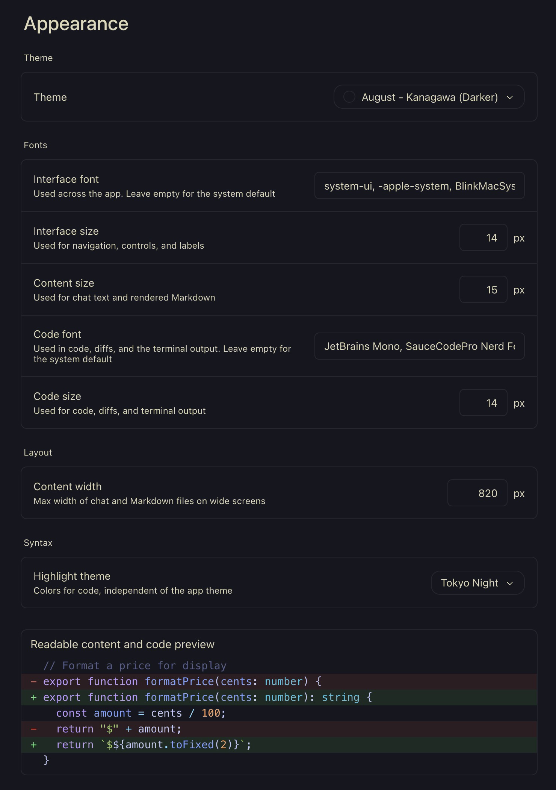

# August Kanagawa Theme for Paseo

A native, client-only theme plugin adapting **August - Kanagawa (Darker)** from [August Themes for VS Code](https://github.com/inci-august/august-themes).



## Install

Requires Paseo 0.12.x. Install directly from GitHub:

```sh
paseo plugin install https://github.com/ivolnistov/paseo-theme-august-kanagawa.git
```

Alternatively, clone the repository and install from its directory:

```sh
paseo plugin install "$PWD"
```

Enable plugins for that host in **Settings → Plugins** if needed, then select **August - Kanagawa (Darker)** in **Settings → Appearance**. For a directory installation, keep that directory in place while the plugin is in use. Development dependencies are not needed to install or run the plugin.

Remove with:

```sh
paseo plugin remove august-kanagawa
```

## Palette

| Paseo color | Hex | VS Code source |
| --- | --- | --- |
| Background | `#16161e` | `editor.background` |
| Foreground | `#dcd7ba` | `editor.foreground` |
| Workspace and raised surfaces | `#16161e` | `editor.background`, `sideBar.background` |
| Controls | `#16161e` | `input.background`, `dropdown.background` |
| Borders | `#ffffff12` | Subtle borders from `workbench.colorCustomizations` |
| Accent | `#658594` | `tab.activeBorderTop` |
| Muted UI text | `#dcd7ba` | `descriptionForeground`, `sideBar.foreground` |
| Focus ring | `#54546d` | `editorLineNumber.foreground` |

Paseo uses the raised color for its workspace and the control color for ordinary inputs as well as selected sidebar rows. These stay dark to match VS Code's main surfaces; selection and hover states cannot be mapped independently through the eight-color API.

This plugin controls app surfaces, primary and muted UI text, accents, and terminal background/foreground. Code highlighting has a separate Appearance setting; Paseo 0.12 offers no native plugin contribution for Kanagawa syntax colors. Terminal ANSI colors, diff/status colors and terminal selection colors remain Paseo's defaults. The focus-ring color also controls extra-muted text and terminal bright black, so it stays opaque rather than copying VS Code's transparent focus border. This is an interface-palette adaptation, not a complete VS Code color-theme port. It does not patch the app or contribute server code.

## Matching VS Code typography

In Settings → Appearance, set Code font to `JetBrains Mono, SauceCodePro Nerd Font Mono, monospace` and Code size to `14` px. These are local app preferences, not settings changed by the plugin. Paseo uses one code size for code, diffs and terminal output; the source VS Code setup uses 14 px for code and 11 px for its terminal.

## Development

```sh
npm ci --ignore-scripts --legacy-peer-deps
npm run typecheck
```

## License and attribution

MIT; see [LICENSE](LICENSE). You may modify and publish this plugin, including on GitHub, while preserving the license and copyright notices.

The palette comes from August Themes **2.8.0**, [`themes/august-kanagawa-darker.json`](https://github.com/inci-august/august-themes/blob/master/themes/august-kanagawa-darker.json). Its package declares MIT and its bundled license contains `Copyright (c) 2018 Sarah Drasner`; that notice is preserved here. August's Kanagawa palette is based on [rebelot/kanagawa.nvim](https://github.com/rebelot/kanagawa.nvim), also MIT. This is an independent adaptation, not an official Paseo or August Themes release.
